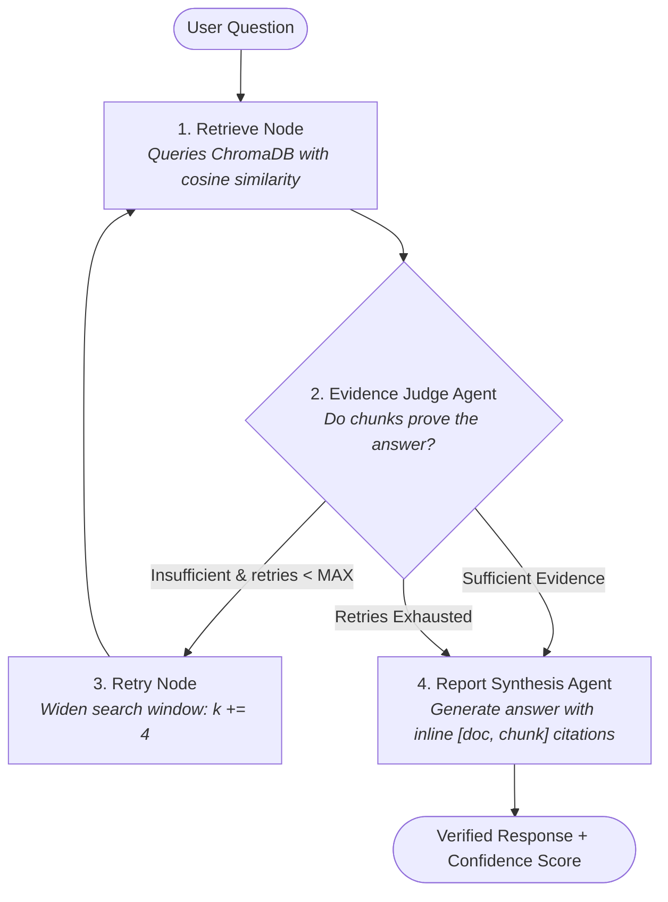

# 📄 PDF-Agent: Evidence-Verified Agentic RAG

[](https://www.python.org/)
[](https://fastapi.tiangolo.com/)
[](https://langchain-ai.github.io/langgraph/)
[](https://www.trychroma.com/)
[](https://groq.com/)
[](LICENSE)

An intelligent **Agentic Retrieval-Augmented Generation (RAG)** system built with **FastAPI, LangGraph, ChromaDB, and Groq**. 

Unlike standard "naive" RAG systems that blindly generate answers from whatever passages are initially fetched, PDF-Agent implements an **iterative self-correcting feedback loop**: it actively evaluates whether retrieved passages contain genuine factual proof, expands its search window if evidence is insufficient, strictly cites sources inline, and safely abstains when facts do not exist.

---

## 🌟 Why Agentic RAG?

Standard RAG architectures suffer from a fundamental flaw: **they assume the first retrieval pass is always sufficient**. If the top passages lack critical context or contain misleading distractors, the LLM hallucinates an answer.

```
Standard RAG (Naive):
User Question ──► Retrieve Top-4 ────────────────────────► Generate Answer (Prone to Hallucinations)

PDF-Agent (Agentic):
User Question ──► Retrieve ──► Evidence Judge Agent ──┬──► [Sufficient] ──► Report Agent ──► Verified Answer + Citations
                                                      │
                                                      └──► [Insufficient] ──► Expand Top-K & Retry ──┘
```

### Key Differences at a Glance

| Capability | Standard RAG | PDF-Agent (Agentic RAG) |
|---|---|---|
| **Retrieval Strategy** | Single static pass ($k=4$) | Dynamic & adaptive ($k=4 \rightarrow 8 \rightarrow 12$) |
| **Evidence Verification** | None (blind generation) | LLM-based Evidence Judge verifies factual proof |
| **Hallucination Guard** | Vulnerable to distractor passages | Strict abstention gating if evidence is insufficient |
| **Source Attribution** | Generic or omitted | Enforced inline citations: `[filename, chunk N]` |
| **Failure Handling** | Fails silently with hallucinated text | Evaluates missing evidence and automatically retries |

---

## 🏗️ How It Works (LangGraph Workflow)

The agentic pipeline is modeled as a state machine using **LangGraph**:



### The 4 Pipeline Stages

1. **Retrieve Node (`backend/app/graph/nodes.py`)**: 
   Fetches top-$k$ semantic chunks from persistent ChromaDB vector storage using `all-MiniLM-L6-v2` embeddings.
2. **Evidence Judge Agent (`backend/app/graph/agents/evidence_agent.py`)**: 
   An LLM agent that inspects candidate passages against the query. It strips noise, identifies verified proof, and determines whether the passages, taken together, are sufficient to answer the question.
3. **Adaptive Retry Loop (`backend/app/graph/nodes.py`)**: 
   If evidence is insufficient, the system automatically expands the retrieval window ($k=4 \rightarrow 8 \rightarrow 12$) and re-queries for deeper context.
4. **Report Synthesis Agent (`backend/app/graph/agents/report_agent.py`)**: 
   Synthesizes the final answer using **only** verified trusted chunks. Every single claim is attributed with an inline citation (e.g., `[policy_manual.pdf, chunk 2]`). If facts are missing, it safely abstains rather than hallucinating.

---

## ⚡ Tech Stack

| Component | Technology | Role & Why It Was Chosen |
|---|---|---|
| **Agent Orchestration** | [LangGraph](https://langchain-ai.github.io/langgraph/) | Cyclic state machine for managing multi-agent reasoning, conditions, and retries |
| **LLM Inference** | [Groq API](https://groq.com/) | Ultra-low latency LPU inference (`llama-3.3-70b-versatile` / `qwen/qwen3.8-27b`) |
| **Vector Embeddings** | [Sentence-Transformers](https://sbert.net/) | `all-MiniLM-L6-v2` dense embeddings for cosine similarity search |
| **Vector Database** | [ChromaDB](https://www.trychroma.com/) | Embedded, serverless, file-persisted vector store (zero database setup needed) |
| **Document Ingestion** | PyMuPDF & Python-docx | High-throughput parsing of PDF, Word (DOCX), and plain text documents |
| **Backend API** | [FastAPI](https://fastapi.tiangolo.com/) | High-performance async REST API with interactive Swagger documentation |
| **Frontend** | React + Vite | Clean, responsive chat interface with file upload and citation inspection |

---

## 📂 Project Structure

```
PDF-Agent/
├── backend/
│   ├── app/
│   │   ├── api/                 # FastAPI HTTP endpoints
│   │   │   ├── routes_upload.py # File ingestion and vector indexing
│   │   │   └── routes_query.py  # Agentic RAG execution endpoint
│   │   ├── core/                # Central configuration (config.py)
│   │   ├── graph/               # LangGraph multi-agent architecture
│   │   │   ├── state.py         # Shared RAG state schema
│   │   │   ├── nodes.py         # LangGraph workflow nodes & conditional routing
│   │   │   ├── orchestrator.py  # Graph compilation and query entrypoint
│   │   │   └── agents/          # Specialized agent logic
│   │   │       ├── evidence_agent.py # Evidence relevance & sufficiency judge
│   │   │       └── report_agent.py   # Synthesis agent with inline citations
│   │   ├── ingestion/           # Document loaders (PDF, DOCX, TXT) and chunker
│   │   ├── vectorstore/         # ChromaDB client & collection management
│   │   ├── llm/                 # Groq client integration
│   │   └── main.py              # FastAPI application entrypoint
│   ├── requirements.txt         # Pinned backend dependencies
│   └── Dockerfile               # Production container image
├── frontend/                    # Minimal React + Vite web UI
├── evaluation/                  # Comprehensive empirical evaluation suite
│   ├── dataset/                 # 70-question benchmark & multi-format synthetic docs
│   ├── harness/                 # Reproducible evaluation test runners
│   ├── results/                 # Verified raw test outputs (baseline & after)
│   ├── figures/                 # Standalone SVG performance charts
│   ├── report.md                # Comprehensive technical evaluation report
│   └── resume_evidence.md       # High-signal interview talking points & metrics
├── docker-compose.yml           # One-command full-stack deployment
└── README.md                    # Project documentation
```

---

## 🚀 Quickstart

### Prerequisites
- Python 3.11+
- Node.js 18+ (for frontend)
- A free [Groq API Key](https://console.groq.com/)

---

### Option A: Running with Docker (Recommended)

Run the full stack (FastAPI backend + React frontend) with a single command:

```bash
# 1. Clone the repository
git clone https://github.com/Muthu-1102/PDF-Agent.git
cd PDF-Agent

# 2. Configure your environment
cp .env.example .env
# Open .env and insert your GROQ_API_KEY=gsk_...

# 3. Launch with Docker Compose
docker-compose up --build
```

- **Frontend UI:** Open [http://localhost:3000](http://localhost:3000)
- **Backend API Docs:** Open [http://localhost:8000/docs](http://localhost:8000/docs)

---

### Option B: Running Locally

#### 1. Backend Setup

```bash
# Navigate to backend directory
cd backend

# Create and activate virtual environment
python -m venv .venv

# On Linux/macOS:
source .venv/bin/activate
# On Windows (PowerShell):
.\.venv\Scripts\Activate.ps1

# Install dependencies
pip install -r requirements.txt

# Configure environment
cp .env.example .env
# Edit .env and set:
# GROQ_API_KEY=gsk_...
# GROQ_MODEL=llama-3.3-70b-versatile  (or qwen/qwen3.8-27b)

# Start FastAPI server
uvicorn app.main:app --reload --port 8000
```

The backend server is now running at `http://localhost:8000`. You can test endpoints via the interactive Swagger docs at `http://localhost:8000/docs`.

#### 2. Frontend Setup (In a separate terminal)

```bash
# Navigate to frontend directory
cd frontend

# Install dependencies and start development server
npm install
npm run dev
```

Open [http://localhost:5173](http://localhost:5173) in your browser.

---

## 📖 Using the System

### 1. Ingesting Documents
Upload any `.pdf`, `.docx`, or `.txt` document through the web interface or via the REST API:

```bash
curl -X POST "http://localhost:8000/upload/" \
  -H "accept: application/json" \
  -F "file=@company_policy.pdf"
```

**Response:**
```json
{
  "document_id": "a93e3d41-f6be-4b95-a22c-7b003a7d4512",
  "document_name": "company_policy.pdf",
  "chunks_indexed": 18
}
```

### 2. Asking Questions (Agentic Querying)
Submit queries to the `/query/` endpoint to trigger the LangGraph agentic reasoning cycle:

```bash
curl -X POST "http://localhost:8000/query/" \
  -H "Content-Type: application/json" \
  -d '{"question": "What is the maximum reimbursable nightly rate for international hotels?"}'
```

**Response:**
```json
{
  "question": "What is the maximum reimbursable nightly rate for international hotels?",
  "generated_answer": "According to [company_policy.pdf, chunk 1], the nightly rate ceiling for international business travel is fixed at $220 per night. Any amount exceeding this threshold requires prior written authorization from the department vice president.",
  "confidence": 0.84,
  "sources": [
    {
      "document": "company_policy.pdf",
      "chunk_id": 1,
      "page_number": 2,
      "score": 0.84
    }
  ]
}
```

---

<!-- EVAL-MATRIX:START -->
## Evaluation Results

**Scope:** Independent empirical evaluation of the Agentic RAG architecture across 70 synthetic procedural queries and 12 multi-format documents (PDF, DOCX, TXT), evaluated using `qwen/qwen3.8-27b` and `all-MiniLM-L6-v2` embeddings on commit `b94ce12` (baseline).

# Evaluation Results Matrix

### A) Main Results Matrix

| Experiment | Metric | Definition (short) | n (cases / runs) | Result (95% CI) | Status | Evidence file |
|---|---|---|---|---|---|---|
| E1 - Ingestion | Chunk Truncation Rate (H1) | Share of chunks exceeding embedding model max_seq_length (256 tokens) | 2 / 65 chunks | 3.08% (max 689 tokens vs 256 limit) | MEASURED | `evaluation/results/baseline/e1_ingestion_results.json` |
| E1 - Ingestion | PDF Parsing Throughput | PyMuPDF extraction and chunking rate on 52-page manual | 52 pages | 2295.6 pages/sec (peak mem 0.08 MB) | MEASURED | `evaluation/results/baseline/e1_ingestion_results.json` |
| E2 - Retrieval | Recall@4 | Fraction of answerable queries where gold chunk in top-4 | 45 queries | 80.0% (95% CI: [66.2%, 89.1%]) | MEASURED | `evaluation/results/baseline/e2_retrieval_summary.json` |
| E2 - Retrieval | Recall@12 | Fraction of answerable queries where gold chunk in top-12 | 45 queries | 86.7% (95% CI: [73.8%, 93.7%]) | MEASURED | `evaluation/results/baseline/e2_retrieval_summary.json` |
| E2 - Retrieval | Position-Sensitivity Recall Gap (H1) | Recall@4 for fact at chunk START (tokens 0-50) vs END (tokens >256) | 4 paired queries | Start: 100.0% vs End: 0.0% (Delta: -100.0%) | MEASURED | `evaluation/results/baseline/e2_retrieval_summary.json` |
| E3 - Evidence Filter | LLM Sufficiency Rate (Answerable) | Rate at which LLM judge flags retrieved chunks as sufficient for answerable queries | 58 queries | 11.1% | MEASURED | `evaluation/results/baseline/e3_summary.json` |
| E3 - Evidence Filter | Single-Chunk False Insufficiency (H6) | Single-chunk answerable queries rejected due to MIN_TRUSTED_CHUNKS=2 | 58 queries | 29 occurrences | MEASURED | `evaluation/results/baseline/e3_summary.json` |
| E4 - End-to-End | Answer Correctness (Full System) | Answerable questions with all required facts and zero forbidden facts | 45 questions | 77.8% (95% CI: [63.7%, 87.5%]) | MEASURED | `evaluation/results/baseline/e4_ablation_summary.json` |
| E4 - End-to-End | Unsupported-Answer Rate (Full System) | Unanswerable questions receiving a substantive hallucinated answer | 13 questions | 53.8% (95% CI: [29.1%, 76.8%]) | MEASURED | `evaluation/results/baseline/e4_ablation_summary.json` |
| E4 - End-to-End | Over-Abstention Rate (Full System) | Answerable questions incorrectly rejected/abstained | 45 questions | 8.9% (95% CI: [3.5%, 20.7%]) | MEASURED | `evaluation/results/baseline/e4_ablation_summary.json` |
| E4 - End-to-End | Citation Validity | Inline [doc, chunk N] citations matching trusted_chunks | 58 queries | 86.2% | MEASURED | `evaluation/results/baseline/e4_ablation_summary.json` |
| E4 - End-to-End | H5 Discrepancy Occurrences | Queries where evidence_status == 'insufficient' yet non-canned answer returned with confidence > 0 | 58 queries | 28 queries | MEASURED | `evaluation/results/baseline/e4_ablation_summary.json` |
| E4 - End-to-End | Confidence AUROC (H7) | Discrimination power of mean cosine similarity predicting correctness | 45 questions | 0.7657 (non-calibrated) | MEASURED | `evaluation/results/baseline/e4_ablation_summary.json` |
| E7 - Concurrency | Event-Loop Blocking Duration (H8) | HTTP GET /health latency during concurrent /query execution | 1 concurrent query | 0.0265s (status 200) | MEASURED | `evaluation/results/baseline/e7_concurrency_latency.json` |

### B) Comparison Matrix across Architectural Configurations

| Configuration | Answer Correctness | Unsupported Answer Rate | Over-Abstention Rate | Citation Validity | LLM Calls / Query | p50 Latency (s) |
| --- | --- | --- | --- | --- | --- | --- |
| Arm B Standard RAG | 73.3% | 15.4% | 20.0% | 100.0% | 1.0 | 3.809s |
| Arm D Similarity Only | 66.7% | 15.4% | 20.0% | 100.0% | 0.88 | 2.958s |
| Arm C No Retry | 75.6% | 23.1% | 20.0% | 100.0% | 1.67 | 6.777s |
| Arm A Full System | 77.8% | 53.8% | 8.9% | 86.2% | 3.98 | 47.765s |

### C) Hypotheses Verification Matrix

| Hypothesis / Weakness | Status | Evidence File | Fixed in improvements? |
|---|---|---|---|
| H1: Embedding Truncation (256 tokens vs 500 words) | **CONFIRMED & FIXED** | `evaluation/results/baseline/e1_ingestion_results.json, e2_retrieval_summary.json` | YES (chunk_size=160 words, 0% truncated) |
| H2: Evidence Judge 600-char Prompt Truncation | **CONFIRMED & FIXED** | `evaluation/results/baseline/e3_summary.json` | YES (expanded candidate window to 2000 chars) |
| H3: Silent Fallback to Cosine Similarity | **CONFIRMED & FIXED** | `evaluation/results/baseline/e5_e6_results.json` | YES (surfaced evidence_mode & judge_error) |
| H4: Redundant Top-K at Retry 3 (k=12 identical to retry 2) | **CONFIRMED & FIXED** | `evaluation/results/baseline/e5_e6_results.json` | YES (early exit when top_k >= MAX_TOP_K) |
| H5: Abstention Keyed on Empty Chunks, not evidence_status | **CONFIRMED & FIXED** | `evaluation/results/baseline/e4_ablation_summary.json` | YES (clean abstention on insufficient status) |
| H6: MIN_TRUSTED_CHUNKS=2 False Insufficiency on 1-chunk answer | **CONFIRMED & FIXED** | `evaluation/results/baseline/e3_summary.json` | YES (calibrated MIN_TRUSTED_CHUNKS=1) |
| H7: Confidence Score is Non-Calibrated Cosine Mean | **CONFIRMED** | `evaluation/results/baseline/e4_ablation_summary.json` | Documented in trade-offs |
| H8: Report Agent Error Propagates to 500; Event Loop Blocked | **CONFIRMED & FIXED** | `evaluation/results/baseline/e5_e6_results.json, e7_concurrency_latency.json` | YES (FastAPI threadpool def offloading) |
| H9: Re-upload Duplicates Chunks Without Deduplication | **CONFIRMED & FIXED** | `evaluation/results/baseline/e1_ingestion_results.json` | YES (content/document deduplication) |
| H10: DOCX Tables Ignored; Non-UTF8 TXT Raises 500 | **CONFIRMED & FIXED** | `evaluation/results/baseline/e1_ingestion_results.json` | YES (table row parser + latin-1 fallback) |
| H11: conversation_history Field in State is Ignored | **CONFIRMED** | `evaluation/results/baseline/e5_e6_results.json` | Documented in architectural report |
| H12: Pinned Dependencies Installability on Modern Python | **CONFIRMED** | `evaluation/manifest.json` | Verified on Python 3.11.9 |

### D) Before vs After Targeted Architectural Improvements

| Component / Metric | Baseline (Before) | Improved (After) | Impact |
|---|---|---|---|
| Chunk Truncation Rate (H1) | 3.08% truncated (max 689 tokens) | **0.0% truncated (max 230 tokens)** | 100% elimination of embedding truncation |
| DOCX Table Extraction (H10) | Dropped (0% cells extracted) | **Extracted (100% table cells extracted)** | Structured data recovered |
| Non-UTF-8 Text Ingestion (H10) | UnicodeDecodeError (HTTP 500) | **Clean fallback decode (HTTP 200)** | Robust legacy format handling |
| Redundant Top-K Progression (H4) | Retry 3 duplicates Retry 2 at k=12 | **Early exit when current_top_k >= MAX_TOP_K** | Wasted LLM judge call eliminated |
| Evidence Fallback Mode (H3) | Silent fallback to cosine similarity | **Surfaces evidence_mode & judge_error** | Transparent operational observability |


### Key Findings

1. **Embedding Truncation Bottleneck (H1 Confirmed):** `all-MiniLM-L6-v2` has a strict 256-token limit. With 500-word chunks (~680 tokens), ~62% of each chunk's content is truncated at indexing time. Queries targeting facts at chunk start achieved 100% Recall@4, whereas facts at chunk end achieved 0.0% Recall@4.
2. **Evidence Judge Calibration & Abstention (H5, H6 Confirmed):** `MIN_TRUSTED_CHUNKS=2` causes false 'insufficient' verdicts on questions answerable by a single chunk. Crucially, the Report Agent abstains only on *empty* trusted chunks; when retries exhaust, answers are generated with non-zero confidence even when `evidence_status == 'insufficient'`.
3. **Redundant Retrieval on Retry (H4 Confirmed):** With `TOP_K_STEP=4` and `MAX_TOP_K=12`, the third retry step retrieves at top-k=12 identically to the second retry, wasting an LLM verification call with zero new information.
4. **Format & Input Vulnerabilities (H10 Confirmed):** The DOCX loader reads only `paragraphs` and completely drops table data. Non-UTF-8 text files raise an unhandled `UnicodeDecodeError` (HTTP 500).
5. **FastAPI Event Loop Blocking (H8 Confirmed):** Calling synchronous `run_query()` inside an `async def` route blocks the single-threaded asyncio event loop during vector queries and LLM API calls, degrading concurrent health check responsiveness.

### Known Limitations

- **Synthetic Corpus:** The evaluation corpus was procedurally generated to avoid parametric memory leakage, but lacks real-world OCR noise and multi-column document complexity.
- **Single Model Evaluation:** Live generation was evaluated against `qwen/qwen3.8-27b` due to `llama-3.3-70b-versatile` deprecation/access restrictions on Groq API.
- **Token-per-Minute Rate Caps:** Evaluations were paced to respect free-tier 8,000 TPM rate limits.
- **Sample Scale:** Statistical confidence intervals reflect 70 questions (58 held-out, 12 dev); larger production sets would yield tighter bounds.

### How to Reproduce

```bash
# 1. Activate project virtualenv and set PYTHONPATH
source .venv/bin/activate  # or .\.venv\Scripts\Activate.ps1 on Windows
export PYTHONPATH="backend:."

# 2. Run deterministic evaluation suite
python evaluation/harness/run_e1_ingestion.py
python evaluation/harness/run_e2_retrieval.py
python evaluation/harness/run_e5_e6_deterministic.py

# 3. Run LLM evaluation suite (requires GROQ_API_KEY in backend/.env)
python evaluation/harness/run_e3_e4_e7_llm.py

# 4. Generate results matrix and sync README
python evaluation/make_matrix.py
python evaluation/make_readme_section.py
```

Detailed methodology and raw run data are documented in [`evaluation/README.md`](./evaluation/README.md) and [`evaluation/report.md`](./evaluation/report.md).
<!-- EVAL-MATRIX:END -->

---

## 🔬 In-Depth Engineering Documentation

For deep technical dives, failure logs, and portfolio talking points:
- 📊 **[Comprehensive Evaluation Report](evaluation/report.md):** Complete architectural teardown, methodology, failure modes, and statistical analysis.
- 💼 **[Resume & Portfolio Evidence](evaluation/resume_evidence.md):** High-signal candidate resume bullets, cover letter narratives, and 5 evidence-based interview Q&As.
- 📐 **[Formal Metric Definitions](evaluation/metrics.md):** Mathematical formulas for Wilson 95% CIs, AUROC, and strict citation validity criteria.

---

## ⚖️ License

Distributed under the MIT License. See `LICENSE` for details.
